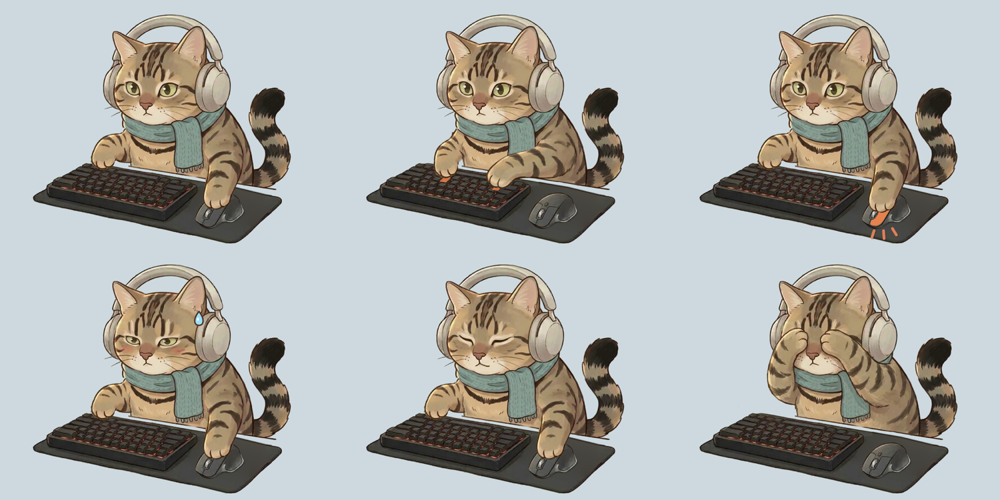

# 墨团 InkCat

一只住在 macOS 桌面上、跟着你一起打字的狸花猫。原生 Swift，没有第三方依赖，不联网。

*A tabby cat that types along with you on the macOS desktop. Native Swift, no dependencies, no network.*


## 能做什么

- **打字**：两只手按标准指法分工，爪子落到你按的那个键，键帽亮起、冒出气泡，快捷键显示为组合键
- **鼠标**：跟手移动，左右键和滚轮都有反应
- **神态**：眨眼、甩尾、打盹；打得快会眯眼、冒汗、微微抖动
- **输密码**：系统开启密码保护（安全输入）时捂眼，不显示任何按键
- **外观**：猫、键盘、桌垫、鼠标、耳机、帽子、围巾可以分别换，[自己的图放进文件夹就生效](docs/CUSTOM_ART.md)；自带原版狸花、电竞套装和英短蓝猫
- **隐私模式**（默认开启）：只跟着敲击节奏动，不读取按键，也不需要权限

右键猫或点菜单栏图标可以调大小、锁定位置、切换隐私模式。对着猫连点三下，它会躲开 10 秒，期间不监听。「设置与演示」里可以换外观，也可以逐个预览和开关动作。



## 安装

需要 macOS 13 以上。

### 下载

1. 在 [Releases](https://github.com/Garymiraclex/inkcat/releases/latest) 下载 DMG（Apple 芯片和 Intel 通用），把 InkCat 拖进「应用程序」。
2. 程序没有经过 Apple 公证，第一次打开会被系统拦住。到「系统设置 → 隐私与安全性」，在页面下方点「仍要打开」。较旧的系统也可以右键 InkCat 选「打开」。

不放心就自己编译，代码都在这里。公司管理的电脑可能不允许打开未公证的程序。

### 自己编译

需要 Xcode 命令行工具（`xcode-select --install`）。

```bash
git clone https://github.com/Garymiraclex/inkcat.git
cd inkcat
./build.sh
open InkCat.app
```

只在一台 Apple 芯片、macOS 26 的 Mac 上测试过；Intel 版只通过 Rosetta 跑过动作测试。

`./release.sh` 可以打包通用版 DMG。

## 隐私

| | 隐私模式（默认） | 关闭隐私模式 |
|---|---|---|
| 权限 | 不需要 | 需要「输入监控」 |
| 知道什么 | 什么时候敲、敲了几下 | 具体是哪个键 |
| 屏幕上显示 | 随机落点的敲击 | 按了什么键 |

- **不联网**：开启 App Sandbox，没有网络权限，代码里也没有网络调用。
- **不记录**：按键不写入文件，只用来驱动动画；偏好设置里只有各项设置和窗口位置，另有一个放素材的文件夹和拆图缓存，都在程序自己的沙盒里。
- **隐藏、锁屏、切换用户时**停止感知键盘（锁屏和切换用户没有在真机上验证）。

需要知道的限制：

- 隐私模式下，别人看屏幕仍能看出打字的节奏和大概次数。
- 关闭隐私模式后，按键会直接显示在屏幕上，录屏和投屏时请留意。
- 捂眼依赖系统的安全输入。一般的密码框会触发，ssh 会话、部分终端和编辑器、远程桌面不会。
- 鼠标的移动、点击和滚轮始终会显示，不需要权限。

### 关闭隐私模式

取消勾选「隐私模式」，在系统弹窗里允许，然后重开墨团。

应用用的是临时签名，**每次更新或重新编译，系统都会把它当成新程序**，之前的授权随之失效。此时在「系统设置 → 隐私与安全性 → 输入监控」里用「−」删掉旧的墨团，重开，再关闭隐私模式即可。

## 代码结构

| 文件 | 内容 |
|---|---|
| `Sources/main.swift` | 窗口、菜单，以及决定键盘输入从哪来 |
| `Sources/InputMonitor.swift` | 读取按键和鼠标（只读） |
| `Sources/KeyCounter.swift` | 隐私模式：只数系统累计的按键次数 |
| `Sources/CatView.swift` | 猫的图层和动作 |
| `Sources/Wardrobe.swift` | 当前的装扮，以及什么时候重新合成 |
| `Sources/Library.swift` | 素材包：扫描、校验、监听文件夹 |
| `Sources/Cutter.swift` | 把整帧图拆成活动部件 |
| `Sources/Composer.swift` | 把选中的部位合成一身装扮 |
| `Sources/Keyboard.swift` | 键位、指法和透视坐标 |
| `Sources/Settings.swift`、`LookPane.swift`、`Demo.swift` | 设置窗口、换装与动作演示 |
| `art/cut.swift` | 用原画生成 `Assets/` 里的内置素材 |

想换成自己的猫、键盘、鼠标、耳机、帽子或围巾：图要怎么画、给生图 AI 的提示词见[素材要求](docs/ART_BRIEF.md)，怎么放进去见[换素材说明](docs/CUSTOM_ART.md)。都不用编译。

## 关于

个人 vibe coding 项目：代码由 Claude Code 编写，原画由 Gemini 生成，部分动作参考了 Gemini 做的另一版，我负责提想法和挑毛病。

灵感来自 [KuroCat](https://github.com/qianyiai/kurocat) 这类桌面打字猫，代码和美术都是独立制作的。

## 许可证

- 代码：[MIT](LICENSE)
- 图片（`Assets/`、`art/`、`docs/`）：[可以修改，可以非商用分享，要署名](LICENSE-ART.md)

*Code is MIT. Images are not covered by MIT: you may modify them and share your versions non-commercially with attribution.*
