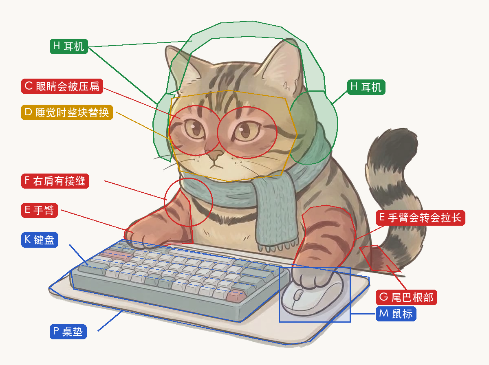

# 素材要求：换键盘、耳机、鼠标、桌垫或猫

这份文档写**图要画成什么样**，可以直接发给画师或生图 AI。怎么装进程序、改哪里的代码，见[换素材说明](CUSTOM_ART.md)。

先看[图片授权](../LICENSE-ART.md)：可以在这些图上改，非商用地分享，要署名。

## 想换什么，要画几张

| 想换 | 要交的图 | 底图 | 放到 |
|---|---|---|---|
| 键盘、鼠标、桌垫 | `cover_eyes.png` | `art/skins/gamer/cover_eyes.png` | `art/skins/gamer/` |
| 耳机（可同时换上面几样） | `idle.png`、`cover_eyes.png` | `art/skins/gamer/` 里的同名图 | `art/skins/gamer/` |
| 猫的毛色、花纹、围巾 | `idle.png`、`type_both.png`、`cover_eyes.png`、`sleep.png` | `art/frames/` 里的同名图 | `art/frames/` |
| 猫的体型或姿势 | 14 张部件 | 见[部件清单](CUSTOM_ART.md#b-部件清单) | `Assets/` |

程序会把整图拆成身体、手臂、尾巴、眼睛、鼠标等活动部件，拆图的轮廓和坐标是固定的。所以除最后一种外，都要**在底图上局部改，机位、姿势、轮廓与底图重合，只换外观**。



## 通用规格

- PNG，1200×896，sRGB，8 位 RGBA。不要 JPEG，不要放大、裁切、补边。
- 真透明背景，不要画棋盘格，不留白边或彩边。耳机头梁和头顶之间也要透明。
- 不要投在背景上的阴影，不要地面、文字、水印。
- 画风一致：暖棕手绘描边，约 4 像素；柔和双层平涂。不要写实产品图或 3D 渲染。
- **键盘、桌垫、耳机、鼠标的外轮廓都要有一圈闭合的深色描边**（亮度低于 100）。脚本靠它区分物体和背景残留，断开的地方会被挖空。
- 底图里头梁内侧和桌垫外沿残留的浅灰不用管，脚本会清掉。
- 没有改的地方一个像素都不要动。多张图之间，没有动作的部分要一致。
- 没有动效线、火花、键帽亮光、气泡，这些由程序画。

坐标以左上角为原点，单位像素。左右按**猫自己的方向**：猫的左手在画面右侧，兼管鼠标。

## 各部位

### K 键盘

- 外轮廓与底图重合，偏差不超过 3 像素。
- **保持 5 排，每个键帽的位置和大小不变**，只换颜色和质感。程序按固定坐标点亮键帽、落爪子（标注图里的五条线是每排的中心）。
- 不加 F 区、旋钮、屏幕、掌托。它们占了键位，亮光就会落在上面。
- 键帽和机身至少差一档明暗，缝隙看得清。键帽上不写字。
- 背光只能是键缝里淡淡的一点，不要整片发光。

### M 鼠标

- 画在 x 684–860、y 655–791 以内，朝向不变，前端朝画面左下。
- 左右键之间要有分界线和滚轮，程序会在那里点亮。
- **外形和电竞皮肤的鼠标一样，就不用改代码**；外形变了，要改轮廓和亮区，见[换素材说明](CUSTOM_ART.md#只换外设皮肤)。
- 和桌垫至少差一档明暗，描边清楚。

### P 桌垫

- 轮廓不变，表面是均匀的单色，不要图案、文字、灯带。鼠标会移动，它下面的桌垫由程序补。
- 颜色选**深色**（亮度 56–92）或**浅色**（亮度 158 以上），中间的灰补不出来。亮度指红绿蓝的平均值，0–255。

### H 耳机

- 两张图里的耳机完全相同；`cover_eyes` 里猫的左臂挡在右耳罩前面，正常遮挡。
- 整副耳机在 x 360–850、y 420 以上。头梁从两耳后面绕过，不改变猫耳；最高到 y = 50。头梁与头顶之间要留空，点 (560, 120) 和 (752, 208) 必须是空的。
- **左耳罩在头的后面，右耳罩在头的前面**，位置和大小照标注图的绿色区域。
- 不挡眼睛（C 区），不画耳机线和麦克风杆。
- 画面右侧的耳罩轮廓变了，要改代码里的 `rim`、`cup`、`cupCover`。

### 猫

- 外轮廓、五官、手臂、爪子与底图偏差不超过 3 像素；尾巴的位置、粗细、长度、弯曲不变。
- **C 眼睛**：会被竖向压扁做眯眼，不画眼镜、眼罩；可以换瞳色。
- **D 脸**：睡觉时整块换成 `sleep.png`，两张图在这里除眼睛外必须一样。
- **E 手臂**：会旋转、拉长、弯曲，花纹简单，不要图案、文字、袖口、手环。
- **F 右肩、G 尾巴根部**：有接缝，毛色均匀，不放饰物。
- 颈部可以换围巾、领结、项圈，下垂部分不超出原围巾。
- 交图时附上毛色主色和描边的十六进制色值，代码里有两处要跟着改。
- 换了猫以后，皮肤也要重新生成一次。

## 给生图 AI 的提示词

每次只改一样，附上底图和标注图，**不要凭文字重新画**，重画会改变比例和机位。

换外设：

```text
以附件 cover_eyes.png 为底图做局部改图，只改【键盘 / 鼠标 / 桌垫】，其余一个像素都不要动。
新外观：【例如：奶白色机身、薄荷绿键帽】。
保持 1200×896、机位、透视、外轮廓完全不变；键盘仍是 5 排，每个键帽的位置和大小不变，不加旋钮、屏幕、F 区、文字。
画风：暖棕色手绘描边约 4 像素，柔和双层平涂，外轮廓描边闭合。
输出 1200×896 的透明背景 PNG，没有背景阴影、动效线、logo、水印。
```

加耳机（先做 `idle.png`，满意后再做另一张）：

```text
以附件 idle.png 为底图，只给猫加一副头戴式耳机，其余一个像素都不要动。
新外观：【例如：天蓝色耳罩、白色头梁】。
头梁从两只猫耳后面绕过头顶，与头顶之间留空并透明；画面左侧的耳罩在头后面，右侧的耳罩盖在脸侧前面，位置照附件标注图的绿色区域。
不挡眼睛，不改变猫耳、脸和围巾，不画线和麦克风。画风和输出要求同上。
```

```text
以附件 cover_eyes.png 为底图，加上与附件 idle.png 完全相同的耳机，位置和大小一致；猫的左臂挡在画面右侧耳罩的前面。其余一个像素都不要动。
```

换毛色：

```text
以附件 idle.png 为底图，只换猫的毛色和花纹：【例如：橘猫，浅橘底色、深橘条纹】。
轮廓、五官、姿势、爪子、尾巴的位置和形状完全不变；手臂花纹简单。键盘、鼠标、桌垫不变。画风和输出要求同上。
```

### 容易翻车的地方

- 图只显示在对话里，没有真的存成文件；或者几张其实是同一张。收图时看一下大小和 MD5。
- 给的是 JPEG，或者把透明背景画成灰底、棋盘格。
- 补一小块时用了几何色块，没有手绘质感，还盖住旁边的东西。让它在原图上重绘那一块。
- 打字那张带着动效线和发光。

## 验收

- [ ] 1200×896，四角 alpha = 0，头梁内侧也是透明的
- [ ] 与底图叠在一起来回切换，没改的地方不跳
- [ ] 键盘仍是 5 排，键帽与底图逐个对齐
- [ ] 外轮廓描边没有断口
- [ ] 放在纯黑和纯白背景上都没有杂边
- [ ] 缩到 260×194，耳机、键盘、鼠标、桌垫分得开
- [ ] 没有 logo 和文字

## 版权

- 用自己的设计，不要用影视、动漫、游戏、品牌的角色、商标或具体产品的外观。
- 分享改过的皮肤要遵守[图片授权](../LICENSE-ART.md)：非商用、署名、注明改动。生图 AI 的条款自己确认。
