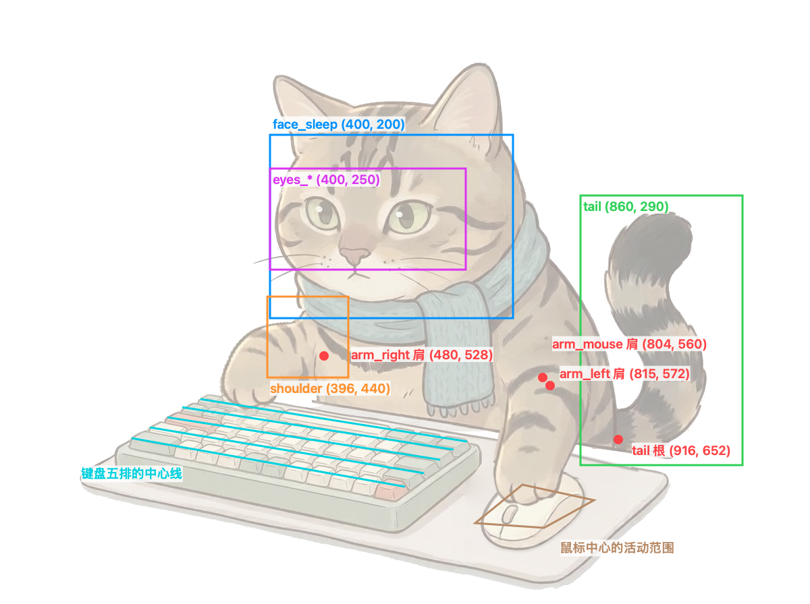

# 换成自己的素材

图要画成什么样、给生图 AI 的提示词，见[素材要求](ART_BRIEF.md)。这里写怎么装进程序、改哪里的代码。

代码是 MIT。仓库里的图可以改，也可以非商用地分享，要署名，见[图片授权](../LICENSE-ART.md)。要商用，就清掉 `Assets/`（含 `Assets/gamer/`）、`art/frames/`、`art/skins/`、`docs/` 里所有原图，换成自己画的，包括 `status.png` 和 README 预览图。

## 选哪种做法

| 做法 | 工作量 | 适合 |
|---|---|---|
| 皮肤：改 1–2 张图，用脚本拆 | 最小 | 猫不变，只换键盘、鼠标、桌垫、耳机 |
| A. 画 4 张整帧图，用脚本拆 | 小 | 换猫，体型、姿势和现在几乎一样 |
| B. 直接画 14 张部件 | 中 | 体型或花纹不同，但坐姿、键盘位置不变 |
| C. 换构图 | 大 | 坐姿或键盘位置不同，要改代码里的坐标 |

所有坐标以 **1200×896** 画布的**左上角为原点**，单位像素。图片用 sRGB、透明背景的 PNG。左右按**猫自己的方向**算：猫的左手在画面右侧，兼管鼠标。



## A. 整帧图

放进 `art/frames/`，都是 1200×896，机位和身体必须逐像素对齐：

| 文件 | 内容 |
|---|---|
| `idle.png` | 左手握鼠标，右手搭在键盘上，睁眼 |
| `type_both.png` | 双手都在键盘上 |
| `cover_eyes.png` | 双手捂眼，鼠标完整露出 |
| `sleep.png` | 闭眼，其余同 `idle` |

脚本只读这 4 张，其余几张是备用的原画。

```bash
swift -O art/cut.swift art/frames Assets
./build.sh && open InkCat.app
```

脚本里的手臂、鼠标、尾巴和桌沿轮廓是照现在这只猫描的。拆出来缺一块或多一块，就改 `art/cut.swift` 中的 `armL`、`armR`、`armM`、`idleL`、`mouse`、`mouseHole`、`inTail`，或改用做法 B。

`status.png`（菜单栏图标）不由脚本生成，要自己替换。

## B. 部件清单

同名替换 `Assets/` 里的文件，尺寸不变：

| 文件 | 尺寸 | 左上角 | 要点 |
|---|---|---|---|
| `plate.png` | 1200×896 | (0, 0) | 身体、脸、键盘、桌垫；**不画**双臂、鼠标、尾巴 |
| `plate_cover.png` | 1200×896 | (0, 0) | 捂眼姿势，手臂画在里面；**不画**鼠标、尾巴 |
| `tail.png` | 240×400 | (860, 290) | 绕图内 (56, 362) 摆动，根部要伸进身体 |
| `face_sleep.png` | 360×272 | (400, 200) | 闭眼的脸，盖在底图上，边缘羽化 |
| `eyes_focus.png` | 290×150 | (400, 250) | 微眯的双眼，边缘羽化 |
| `eyes_tense.png` | 290×150 | (400, 250) | 眯得更紧 |
| `mouse.png` | 176×136 | 会移动 | 中心在对位图的褐色范围内移动 |
| `arm_left.png` | 240×400 | 会转动 | 打字的左臂，竖直：肩在 (120, 80)，爪尖在 (120, 313) |
| `arm_mouse.png` | 240×400 | 会转动 | 握鼠标的左臂，竖直：肩在 (120, 80)，爪尖在 (120, 231) |
| `arm_right.png` | 140×175 | 会弯曲 | 展平的右臂：肩在上，爪在下，底部 76 像素是爪子 |
| `arm_right_in.png` | 140×175 | 会弯曲 | 同上，用于手往内够；内侧（图的右边）羽化 |
| `shoulder.png` | 120×120 | (396, 440) | 手往内够时盖住右臂根部，朝手臂一侧羽化 |
| `icon.png` | 1024×1024 | | 应用图标，四周留约 100 像素 |
| `status.png` | 36×36 | | 菜单栏图标，只用黑色加透明 |

叠放顺序，从下到上：尾巴 → 底图 → 眯眼 → 闭眼 → 键帽亮光 → 鼠标 → 手臂 → 气泡。

手臂最容易露馅：

- **肩端要羽化**，越过肩点后渐隐，转动时才不会露出硬边。
- **左臂会拉伸**：`arm_left` 约第 127–220 行、`arm_mouse` 约第 110–171 行会被拉长，这一段花纹尽量简单。
- **右臂会切成薄片弯曲**，爪子部分不伸缩。

## 只换外设（皮肤）

猫不变，只换键盘、鼠标、桌垫，或者再加耳机。最省事的是直接替换电竞皮肤：

1. 按[素材要求](ART_BRIEF.md)改图，替换 `art/skins/gamer/` 里的同名文件。不要耳机就删掉那里的 `idle.png`。
2. 生成素材并编译：

   ```bash
   swift -O art/cut.swift art/frames Assets/gamer art/skins/gamer
   ./build.sh && open InkCat.app
   ```

3. 在「设置与演示 → 外观」里选电竞，逐个演示看一遍。想改名字，改 `Sources/Skin.swift` 的 `title`。

想另加一套：新建 `art/skins/<名字>/` 和 `Assets/<名字>/`，在 `Skin` 里加一项，补上 `title` 和 `mouseParts`，并在 `build.sh` 复制 `Assets/gamer` 的那一行加上新目录。某套皮肤里没有的图，会沿用 `Assets/` 里的原版。

外形和电竞皮肤不同时，要改：

| 变了什么 | 改哪里 |
|---|---|
| 鼠标轮廓 | `art/cut.swift` 里 `if let skin` 一段的 `mouse`（外沿）和 `hole`（外沿再放大几像素，盖住阴影） |
| 鼠标左右键、滚轮的亮区 | `Sources/Skin.swift` 的 `mouseParts`，以 (684, 655) 为原点 |
| 画面右侧的耳罩轮廓 | 同一段的 `rim`、`cup`、`cupCover` |
| 头梁与头之间的空隙 | 同一段的 `holes`，每个空隙里取一个点 |

也可以不用脚本，直接照[部件清单](#b-部件清单)画好，放进 `Assets/gamer/`。

## 换毛色和画风时要改的代码

都在 `Sources/CatView.swift`，除非另有说明：

| 内容 | 位置 |
|---|---|
| 右肩补块的毛色和描边（**换毛色必改**） | `buildJoint()` 里的 `0xB59B70`、`0x3B2418` |
| 描边、气泡、亮光、火花的颜色 | 文件开头的 `ink`、`paper`、`glow`、`spark` |
| 鼠标左右键和滚轮的亮区 | `Sources/Skin.swift` 的 `mouseParts`，换鼠标造型时改 |
| 腮红、汗滴的位置 | `buildMood()` |
| 气泡按键种类的配色 | `Keyboard.swift` 的 `tint` |
| 桌垫上沿补线的颜色（只影响做法 A） | `art/cut.swift` 的 `SIMD4(0.24, 0.16, 0.13, 1)` |

## C. 换构图

| 内容 | 位置 |
|---|---|
| 键盘五排的两端 | `Keyboard.swift` 的 `ends` |
| 键帽亮光的倾斜 | `CatView.swift` 的 `build()`，变量 `d` |
| 三条手臂的肩点和长度 | `build()`、`BendyArm.reach()` |
| 起手位 | `leftHome`、`rightHome` |
| 鼠标活动范围 | `moveMouse()` |
| 各部件的左上角 | `CatView` 开头的属性，`shoulder` 在 `BendyArm` |

## 检查

`./build.sh` 后打开「设置与演示」→「全部演示」，重点看：左右手打字的肩部接缝、握鼠标与打字之间的切换、甩尾的根部、眨眼时脸的边缘、捂眼时有没有多出来的手臂。
